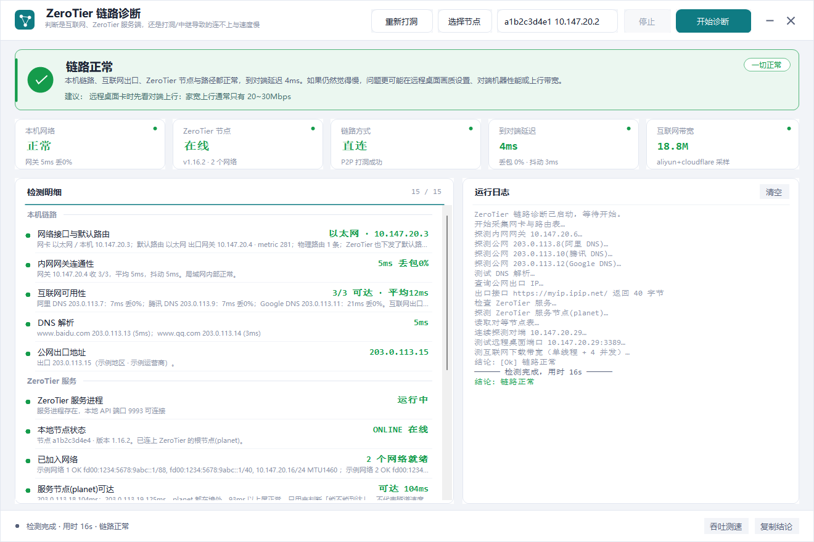
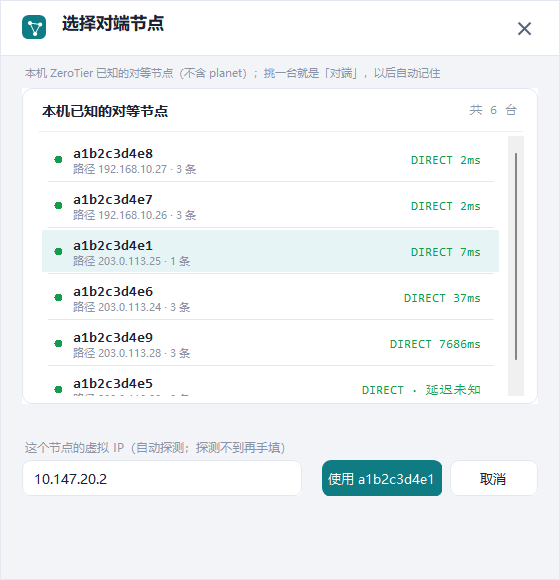
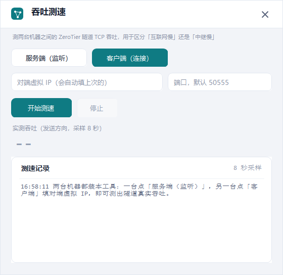
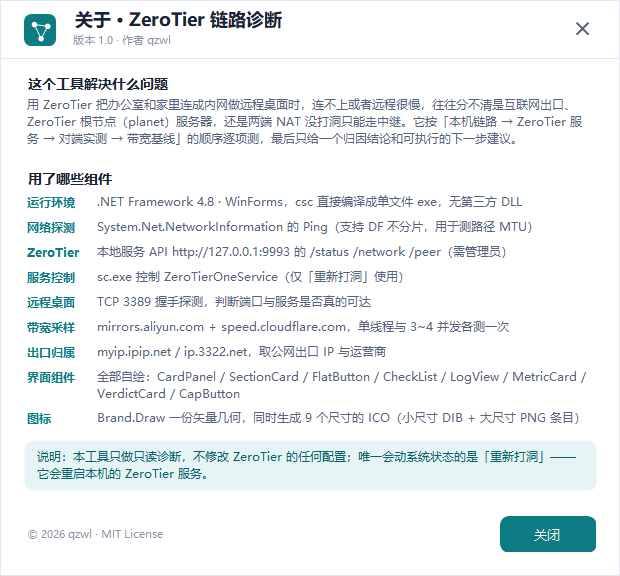

# ZeroTier 链路诊断

一个**单文件 Windows 桌面工具**，用来回答一个很具体的问题：

> 办公室里连不上家里的电脑、或者远程桌面卡得不行，到底是**互联网链路**的问题，还是 **ZeroTier 服务器（planet）/ NAT 打洞中继**的问题？

它按「本机链路 → ZeroTier 服务 → 对端实测 → 带宽基线」的顺序逐项测，最后只给**一个归因结论 + 能立刻执行的下一步建议**。界面即报告，不导出任何文件。

- 单文件 exe，零依赖（只用系统自带的 .NET Framework 4.8），双击即用
- 双击自动请求管理员权限（读 ZeroTier 本地 API 必须要）
- 对端节点**不用手填**：自动列出本机已知的对等节点，选一次后长期记住，下次启动自动开始诊断
- 无边框自绘界面，窗口图标与界面 logo 由同一份矢量几何生成
- 作者：**qzwl**

> 本仓库**只发布编译好的 exe，不提供源码**。

## 下载与运行

| 文件 | 大小 | SHA-256 |
|---|---|---|
| `ZeroTier链路诊断.exe` | 174,592 字节（约 170 KB） | `c0fe7e422318619f228668a0df031394a75b5d08ba88fb92c16ba248f7ec9709` |

1. 下载 exe，双击运行（会弹一次 UAC，点「是」）。
2. 系统要求：Windows 10 / 11，装有 .NET Framework 4.8（Win10 1903 之后和 Win11 都自带）。
3. 首次运行点「选择节点」挑一次对端，之后每次打开会自动诊断。

exe 未做代码签名，SmartScreen 可能提示「未知发布者」，点「更多信息 → 仍要运行」即可；可用上表的 SHA-256 校验下载是否完整。

详细用法（打洞失败怎么重打、带宽为什么测得低、提速排查顺序）见 [使用说明.md](使用说明.md)。

## 界面

| 主界面 | 选择节点 |
|---|---|
|  |  |

| 吞吐测速 | 关于 |
|---|---|
|  |  |

截图里出现的节点 ID、虚拟 IP、出口归属地与性能数字**全部是示例数据**，不是任何真实环境。

## 它查什么（7 步 15 项）

| 分组 | 检测项 | 说明 |
|---|---|---|
| 本机链路 | 网卡与默认路由 | 是否拿到 DHCP、默认路由是否被 ZeroTier 接管 |
| | 内网网关连通性 | 到路由器/交换机的丢包与抖动，先排除本地这一段 |
| | 互联网可用性 | 阿里/腾讯/Google DNS 三个公网目标的延迟、丢包、抖动 |
| | DNS 解析 | 解析成功率与耗时 |
| | 公网出口地址 | 出口 IP 与运营商（据此判断是否走了 ZeroTier 全局出口） |
| ZeroTier 服务 | 服务进程 | ZeroTierOneService 与本地 API 9993 是否活着 |
| | 本地节点状态 | ONLINE / OFFLINE、节点 ID、版本 |
| | 已加入网络 | 每个网络的 OK / ACCESS_DENIED / 配置中，虚拟 IP 与 MTU |
| | planet 可达 | 根节点 ICMP 可达性与延迟 |
| | 对等节点与打洞 | 直连几台、中继几台，每个 peer 的路径与延迟 |
| 对端实测 | 链路方式 | **DIRECT 直连 / 经 planet 中继**（无路径但有 ICMP 回包时判定为中继） |
| | 延迟与丢包 | 连续 ICMP，给出平均值、丢包率、抖动 |
| | 大包与 MTU | 带 DF 的 2800/2400/1800/1472 字节探测，找路径 MTU 截断 |
| | 远程桌面端口 3389 | TCP 握手，验证隧道、权限与对端远程桌面服务 |
| 带宽基线 | 互联网下载带宽 | 单线程 + 3~4 并发各测一次，取并发值（更接近浏览器实际速度） |

## 结论怎么读（归因分支）

- **局域网 / 本机网络**：网关就在丢包，先修网线、Wi-Fi、交换机或校园网认证。
- **互联网出口**：网关通、公网全不通（校园网未认证、运营商故障）。
- **互联网 ↔ ZeroTier 服务器**：公网正常但 planet 不可达 → UDP 9993 / 443 被防火墙或运营商拦截。
- **UDP 拦截 / ZeroTier 服务端**：planet 有回包但节点 OFFLINE → 出站 UDP 发不出去，或被服务端拒绝。
- **NAT 打洞失败（走中继）**：节点在线、互联网正常，但到对端没有直连路径、ICMP 却能通（延迟≈planet 延迟）→ 数据经 planet 中转，延迟高、带宽被限，**不是互联网坏了**。
- **互联网链路质量**：能连上但对端/公网有丢包抖动 → 换出口对比。
- **对端服务 / 端口**：网络通、3389 不通 → 对端没开远程桌面或被防火墙拦。
- 全绿 **链路正常**：慢的原因更可能在远程桌面画质、对端性能或上行带宽。

## 特色功能

### 「重新打洞」

两端的 ZeroTier 一直走中继时，最常见的原因不是 NAT 真的不通，而是**路径状态卡住**。点一次「重新打洞」= `sc stop/start ZeroTierOneService` + 轮询节点重新 ONLINE + 自动重测路径。

一次典型的前后对照（示例数据）：

| | 到对端节点的路径 | ICMP | MTU | 结论 |
|---|---|---|---|---|
| 重启前 | 无路径 / 经 planet 中继 | 约 400ms | 1500 截断 | NAT 打洞失败（走中继） |
| 重启后 | **DIRECT 直连** | 约 4ms | 2800 全通 | **链路正常** |

> 注意：打洞是两端的事。家里那台也点一次成功率更高；若一方是对称 NAT / UDP 9993 被挡，重启再多次也打不通，此时按工具给的建议走 UPnP、端口映射、或自建 moon。

### 对端免手填

1. 点「选择节点」→ 工具读本地 ZeroTier API 列出所有对等节点（排除 planet），在线优先、延迟升序；
2. 每行显示 `节点ID / 路径IP·路径数 / DIRECT 或 无路径 · 延迟`，点一行再点「使用此节点」；
3. **虚拟 IP 会自动探测**：读本机 ARP 表里同网段出现过的主机，再对整段做并行 ICMP 扫描，按与该节点路径延迟的接近程度排序，挑最接近的一台填进输入框，并在下方一行说明「探到几台、填了哪一台、不对请改」；
4. 选中后节点 ID 与虚拟 IP 写入 `%APPDATA%\ZeroTierDiag\settings.txt`（`last=` / `map=`），下次打开自动诊断，不再探测；
5. 为什么不能 100% 自动：ZeroTier 本地 API 不提供「节点 ID → 虚拟 IP」映射（`/network/<nwid>` 只给本机自己的地址），节点地址由公钥派生，没有可查的 IPv4↔nodeId 对照表。所以只能从「同网段谁活着 + 谁的延迟和这个节点接近」推，探不到或明显不唯一时，工具会把现象写在提示行里让你改一次；改一次以后就永久记住。

### 吞吐测速

右下角「吞吐测速」：两台机器都装本工具，一台点「服务端（监听）」、另一台点「客户端」（会自动填上次的对端 IP），8 秒采样，用来区分「互联网本来就慢」和「隧道/中继慢」。对端默认端口 50555，首次运行记得在防火墙里允许。

## 命令行（可选，便于脚本化）

```text
ZeroTier链路诊断.exe                        # 正常使用（自动读上次对端并开测）
ZeroTier链路诊断.exe a1b2c3d4e5 10.147.20.5 # 指定对端（节点 ID 与虚拟 IP 可任缺其一）
ZeroTier链路诊断.exe --fast                 # 快速模式（跳过部分耗时项）
ZeroTier链路诊断.exe --speed-server 50555 out.txt
ZeroTier链路诊断.exe --speed-client 10.147.20.5 50555 out.txt
```

`--snapshot <目录> --fast` 会把各页面离屏截成 png 并写一份 `snapshot.log`（含完整 Facts 与 15 项明细），用于无人值守时复核界面；加 `--redact` 会把节点 ID、网络 ID、IP、MAC、出口归属地、网络名以及**实测性能数字**统一换成示例值（数值按固定比例缩放，同一原始值每次换算结果一致），所以可以安全地公开分享截图。

## 已知边界

- 读取 ZeroTier 本地 API（`/status` `/network` `/peer`、`authtoken.secret`）**必须管理员**，普通权限下相关项会明确标为「受限」。
- 只做**只读诊断**：唯一会改动系统状态的操作是「重新打洞」（重启本机 ZeroTier 服务）。
- 部分网络里 planet 的 TCP 443 被完全拦掉，只能靠 ICMP 判断，因此「planet 可达」用的是 ICMP 而不是 TCP。
- ZeroTier 本地 API 不提供「节点 ID → 虚拟 IP」映射，所以虚拟 IP 是「同网段探测 + 延迟最接近」推出来的建议值，探测不到或明显不唯一时按提示改一次（改完永久记住）。
- 吞吐测速需要两端都运行本工具，且一方在防火墙放行所选端口；跨隧道真机吞吐受上行带宽影响明显。
- 账号下若有本身是 `ACCESS_DENIED` 的加入网络，工具会如实报 Warn，不去「修复」你的网络授权。

## 许可

MIT，见 [LICENSE](LICENSE)。作者：qzwl。
